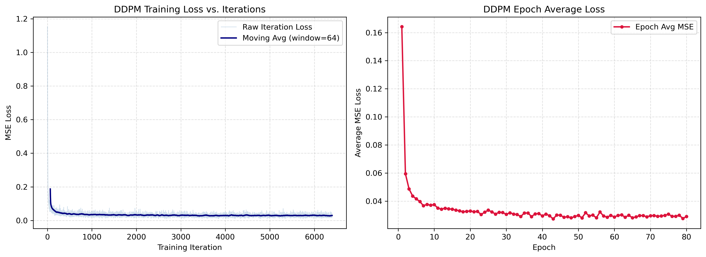
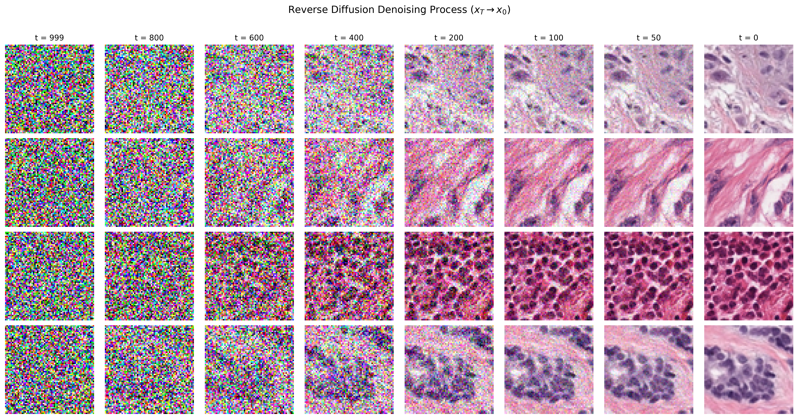

# ECE 285 Homework 3: DDPM for Histopathology Image Generation

Implementation and experimental results of a **Denoising Diffusion Probabilistic Model (DDPM)** trained from scratch on the **Histopathology** dataset (`5,179` images) using **Apple Silicon MPS (`mps`)** hardware acceleration.

## Overview

- **Model**: Time-conditioned U-Net (`26,623,363` parameters) with sinusoidal timestep embeddings, residual blocks (`GroupNorm` + `SiLU`), multi-head self-attention at `16x16` and `8x8` resolutions, and Exponential Moving Average (`EMA`, decay = `0.9999`).
- **Diffusion Process**: $T = 1000$ timesteps with a linear noise schedule ($\beta_{\text{start}} = 10^{-4}$, $\beta_{\text{end}} = 0.02$), MSE noise-prediction objective, and 1,000-step ancestral DDPM sampling (plus optional DDIM sampling).
- **Dataset**: [Histopathology Image Collection](https://www.kaggle.com/datasets/rushilprajapati/data-final) (`5,179` RGB PNG images resized to `64 x 64` with random horizontal/vertical flips).
- **Evaluation**: Fréchet Inception Distance (**FID**) and Inception Score (**IS**) computed via **PyTorch-Ignite** (`ignite.metrics.FID` & `ignite.metrics.InceptionScore`) following [PyTorch-Ignite's FID/IS guide](https://pytorch-ignite.ai/blog/gan-evaluation-with-fid-and-is/).

## Repository Structure

```text
.
├── HW03.ipynb                                       # Main DDPM training & evaluation notebook (MPS accelerated)
├── Homework_3.pdf                                   # Assignment specification
├── 2021-08-11-GAN-evaluation-using-FID-and-IS.ipynb # Reference PyTorch-Ignite FID/IS evaluation notebook
├── outputs/                                         # Saved metrics, loss curves, and generated image grids
│   ├── hyperparameters.json
│   ├── metrics_summary.json
│   ├── training_loss_curve.png
│   ├── real_samples.png
│   ├── real_vs_generated.png
│   ├── generated_samples.png
│   ├── denoising_trajectory.png
│   └── samples_epoch_*.png
└── README.md
```

> **Note**: `data/` (`~514 MB`) and `checkpoints/` (`~620 MB`) are excluded from version control via `.gitignore`.

## Hyperparameter Settings

| Category | Parameter | Value |
| :--- | :--- | :--- |
| **Data** | Image Resolution | `64 x 64 x 3` |
| | Dataset Size | `5,179` PNG images |
| | Augmentation | Random Horizontal & Vertical Flip ($p = 0.5$) |
| **U-Net** | Base Channels / Multipliers | `64` / `(1, 2, 4, 4)` |
| | Residual Blocks per Level | `2` |
| | Self-Attention Resolutions | `16x16`, `8x8` (`4` heads) |
| | Dropout | `0.1` |
| | Trainable Parameters | `26,623,363` (`26.62M`) |
| **Diffusion** | Timesteps ($T$) | `1,000` |
| | Beta Schedule | Linear (`1e-4` to `0.02`) |
| **Training** | Optimizer | `AdamW` (`lr = 2e-4`, `weight_decay = 1e-4`) |
| | LR Scheduler | `CosineAnnealingLR` ($\eta_{\min} = 10^{-6}$) |
| | Batch Size / Epochs | `64` / `80` |
| | Gradient Clipping / EMA | `1.0` / `0.9999` |
| | Accelerator | Apple Silicon `mps` |

## Quantitative Results

Evaluated on `1,024` real/generated image pairs using **1,000-step DDPM sampling** and **PyTorch-Ignite**:

| Metric | Value |
| :--- | :--- |
| **Final Epoch MSE Loss (Epoch 80)** | `0.02905` |
| **Best Epoch MSE Loss** | `0.02732` |
| **FID Score** (lower is better) | `0.0422` |
| **Inception Score** (higher is better) | `1.8380` |

## Visual Results

### Training Loss Curve


### Real vs. Generated Histopathology Images


### Generated Samples Grid (`8 x 8`)


### Reverse Diffusion Denoising Trajectory ($x_T \rightarrow x_0$)


## How to Run

1. **Prepare the Dataset**: Download the Histopathology image collection and place the `.png` files under `./data/Histopathology/`.
2. **Install Dependencies**: Ensure you have Python 3.10+ with PyTorch (`mps`, `cuda`, or `cpu` support) and the required packages installed:
   ```bash
   pip install torch torchvision pytorch-ignite matplotlib numpy pillow tqdm scipy
   ```
3. **Run the Notebook**: Open `HW03.ipynb` in Jupyter and execute the cells sequentially. The notebook automatically detects available hardware acceleration (`mps` on Apple Silicon, `cuda` on NVIDIA GPUs, or `cpu`) and saves all plots, evaluation metrics, and checkpoints to `outputs/` and `checkpoints/`.
