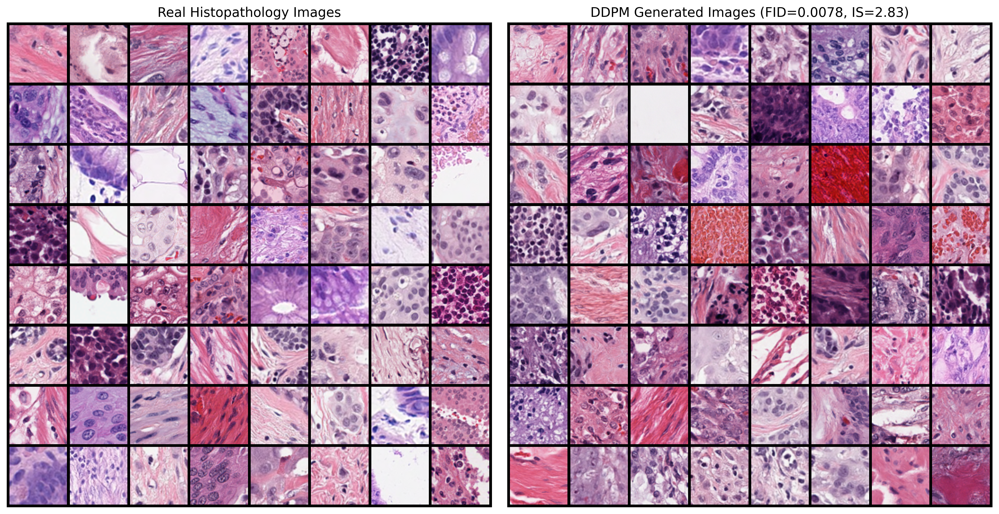
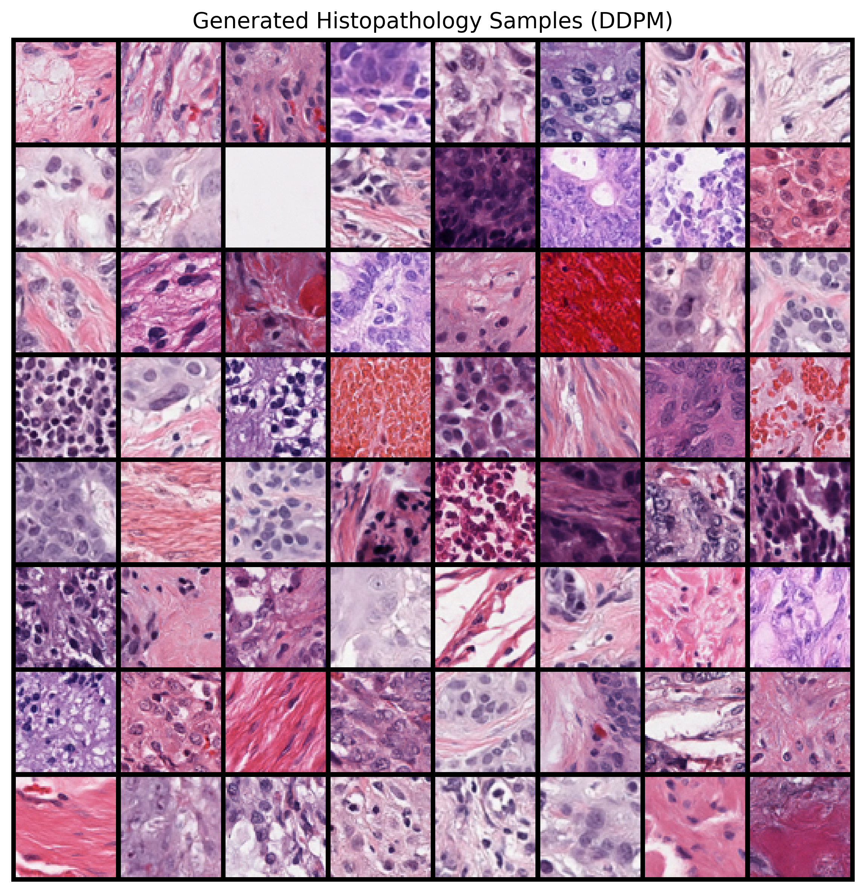

# ECE 285 Homework 3: DDPM for Histopathology Image Generation

Implementation and experimental results of an improved **Denoising Diffusion Probabilistic Model (DDPM)** trained from scratch on the **Histopathology** dataset (`5,179` images).

## Overview

- **Model**: Time-conditioned U-Net (`27,659,587` parameters) featuring sinusoidal timestep embeddings, **Adaptive Group Normalization (`AdaGN` / Scale-Shift)** residual blocks (`GroupNorm` + `SiLU`, `dropout = 0.05`), zero-initialized residual/output projections, FlashAttention (`scaled_dot_product_attention`) at `16x16` and `8x8` resolutions, and Exponential Moving Average (`EMA`, decay = `0.9995`).
- **Diffusion Process**: $T = 1000$ timesteps with a **cosine noise schedule** ($s = 0.008$, $\beta_t \in [10^{-4}, 0.999]$), **Min-SNR-$\gamma$ loss weighting** ($\gamma = 5.0$) to balance gradients across noise levels and prevent H&E color drift, **dynamic quantile thresholding** ($p = 0.995$), and 1,000-step ancestral DDPM sampling (plus 100-step DDIM sampling for fast previews).
- **Dataset**: [Histopathology Image Collection](https://www.kaggle.com/datasets/rushilprajapati/data-final) (`5,179` RGB PNG images resized to `64 x 64` via antialiased `BICUBIC` interpolation, cached in RAM, and augmented with lossless 8-fold $D_4$ dihedral flips and $90^\circ$ rotations).
- **Evaluation**: Fréchet Inception Distance (**FID**) and Inception Score (**IS**) computed on `2,048` real/generated pairs via **PyTorch-Ignite** (`ignite.metrics.FID` & `ignite.metrics.InceptionScore`) following [PyTorch-Ignite's FID/IS guide](https://pytorch-ignite.ai/blog/gan-evaluation-with-fid-and-is/).

## Repository Structure

```text
.
├── HW03.ipynb                                       # Main DDPM training & evaluation notebook
├── 2021-08-11-GAN-evaluation-using-FID-and-IS.ipynb # Reference PyTorch-Ignite FID/IS evaluation notebook
├── outputs/                                         # Saved metrics, loss curves, and generated image grids
│   ├── hyperparameters.json
│   ├── metrics_summary.json
│   ├── training_loss_curve.png
│   ├── real_samples.png
│   ├── real_vs_generated.png
│   ├── generated_samples.png
│   ├── denoising_trajectory.png
│   └── samples_epoch_*.png
└── README.md
```

> **Note**: `data/` (`~514 MB`) and `checkpoints/` (`~680 MB`) are excluded from version control via `.gitignore`.

## Hyperparameter Settings

| Category | Parameter | Value |
| :--- | :--- | :--- |
| **Data** | Image Resolution | `64 x 64 x 3` (`PIL.Image.BICUBIC`, cached in RAM) |
| | Dataset Size | `5,179` PNG images |
| | Augmentation | $D_4$ Dihedral Group: Random H-Flip ($p = 0.5$) + Random $90^\circ$ Rotation |
| **U-Net** | Base Channels / Multipliers | `64` / `(1, 2, 4, 4)` with **AdaGN** (Scale-Shift) |
| | Residual Blocks per Level | `2` (Zero-Initialized second conv & output conv) |
| | Self-Attention Resolutions | `16x16`, `8x8`, and bottleneck (`4` heads, SDPA) |
| | Dropout | `0.05` |
| | Trainable Parameters | `27,659,587` (`27.66M`) |
| **Diffusion** | Timesteps ($T$) | `1,000` |
| | Beta Schedule | Cosine ($s = 0.008$, $\beta_t \in [10^{-4}, 0.999]$) |
| | Loss Objective | Min-SNR-$\gamma$ Weighted MSE ($\gamma = 5.0$) |
| | Sampling Thresholding | Dynamic Quantile Thresholding ($p = 0.995$) |
| **Training** | Optimizer | Fused `AdamW` (`lr = 2e-4`, `weight_decay = 1e-4` on matrix weights) |
| | LR Scheduler | `1,000`-step Linear Warmup + Per-step Cosine Decay ($\eta_{\min} = 2 \times 10^{-5}$) |
| | Batch Size / Epochs | `32` / `400` (`64,400` total gradient updates) |
| | Precision / Grad Clip / EMA | `bfloat16` AMP / `1.0` / `0.9995` |

## Quantitative Results

Evaluated on `2,048` randomly sampled real/generated image pairs using **1,000-step DDPM sampling** and **PyTorch-Ignite**:

| Metric | Value |
| :--- | :--- |
| **Final Epoch Min-SNR Loss (Epoch 400)** | `0.02294` |
| **Best Epoch Min-SNR Loss** | `0.02224` |
| **Final / Best Epoch Unweighted MSE** | `0.05932` / `0.05568` |
| **FID Score** (lower is better) | **`0.0078`** |
| **Inception Score** (higher is better) | **`2.8267`** |

## Visual Results

### Training Loss Curve


### Real vs. Generated Histopathology Images


### Generated Samples Grid (`8 x 8`)


### Reverse Diffusion Denoising Trajectory ($x_T \rightarrow x_0$)


## How to Run

1. **Prepare the Dataset**: Download the Histopathology image collection and place the `.png` files under `./data/Histopathology/`.
2. **Install Dependencies**: Ensure you have Python 3.10+ with PyTorch and the required packages installed:
   ```bash
   pip install torch torchvision pytorch-ignite matplotlib numpy pillow tqdm scipy
   ```
3. **Run the Notebook**: Open `HW03.ipynb` in Jupyter and execute the cells sequentially. The notebook automatically configures CUDA `bfloat16` / MPS / CPU acceleration, caches resized tensors, and saves all plots, evaluation metrics, and checkpoints to `outputs/` and `checkpoints/`.
